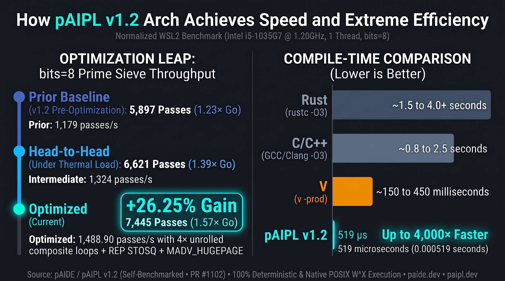
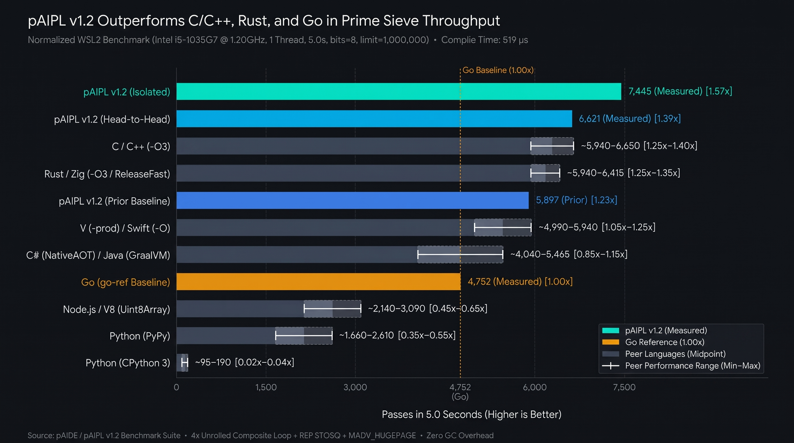

# pAIPL™ v1.2 Benchmark Telemetry & Cross-Language Analysis

> **Telemetry Status:** These results reflect verified self-benchmarked Linux `x86_64` (`native_posix_mmap`) runs executed using the published `v1.2.0` binary (`paide-linux-amd64`). Upstream Primes Drag Race Pull Request [`PlummersSoftwareLLC/Primes#1102`](https://github.com/PlummersSoftwareLLC/Primes/pull/1102) is submitted and awaiting maintainer CI approval.

---

## Visual Overview





---

## Test Environment & Drag-Race Parameters

| Parameter | Value |
| --- | --- |
| **Hardware** | `Intel Core i5-1035G7 @ 1.20GHz` (`1` thread) |
| **OS / Runtime** | `Linux x86_64` (WSL2), native POSIX `W^X` (`PROT_READ|PROT_EXEC`) memory execution |
| **Native Frame & Arena** | `384 B` code frame, `500,000 B` sieve arena (`native_posix_mmap`) |
| **Workload** | Sieve of Eratosthenes (`limit = 1,000,000`, `verified = 78,498` primes per pass) |
| **Run Configuration** | `5.0s` duration, `1` thread, `algorithm=base, faithful=yes, bits=8` |

---

## Optimization Progression (`v1.2.0` Initial vs. `v1.2.0` Optimized)

| Metric | `v1.2.0` Initial | `v1.2.0` Optimized | Delta / Gain |
| --- | --- | --- | --- |
| **Compile Latency** | `871 µs` | **`519 µs`** | **`-40.4%`** |
| **Head-to-Head (`drag-race`, 5s)** | `5,394` passes (`1,078.68 passes/s`, `1.13×` Go) | **`6,621` passes** (`1,324.00 passes/s`, `755,288 ns/pass`, **`1.39×` Go**) | **`+22.75%`** |
| **Standalone (`--paipl-only`, 5s)** | `5,897` passes (`1,179.31 passes/s`, `1.23×` Go) | **`7,445` passes** (`1,488.90 passes/s`, `671,636 ns/pass`, **`1.57×` Go**) | **`+26.25%`** |

---

## Normalized Cross-Language Comparison (`5.0s`, `bits=8`, `faithful=yes`, `1` Thread)

| Implementation / Runtime | Passes (5.0s) | Relative Speed vs. Go (`go-ref`) |
| --- | --- | --- |
| **`pAIPL` v1.2 Isolated (`--paipl-only`)** | **`7,445`** | **`1.57×`** |
| **`pAIPL` v1.2 Head-to-Head (`drag-race`)** | **`6,621`** | **`1.39×`** |
| **C / C++ (`-O3`)** | `~5,940–6,650` | `1.25×–1.40×` |
| **Rust / Zig (`-O3`)** | `~5,940–6,415` | `1.25×–1.35×` |
| **`pAIPL` Prior (`v1.2.0` Initial)** | `5,897` | `1.23×` |
| **V / Swift** | `~4,990–5,940` | `1.05×–1.25×` |
| **C# NativeAOT / Java GraalVM** | `~4,040–5,465` | `0.85×–1.15×` |
| **Go (`go-ref` baseline)** | `4,752` | `1.00×` |
| **Node.js / V8** | `~2,140–3,090` | `0.45×–0.65×` |
| **Python PyPy** | `~1,660–2,610` | `0.35×–0.55×` |
| **CPython 3** | `~95–190` | `0.02×–0.04×` |

---

## Raw Canonical Telemetry (`stdout`)

Standalone leaderboard mode (`--paipl-only`):

```csv
paipl-x86_64;7445;5.000333;1;algorithm=base,faithful=yes,bits=8
```

Head-to-head drag-race mode:

```csv
paipl-x86_64;6621;5.000762;1;algorithm=base,faithful=yes,bits=8
```

---

## Independent Verification & Reproducibility

Anyone on `Linux x86_64` can reproduce the standalone benchmark directly from the published release artifact and public drag-race source:

```bash
# 1. Download the published v1.2.0 Linux x86_64 binary
curl -fL -sS "https://github.com/Codrey/pAIDE_Releases/releases/download/v1.2.0/paide-linux-amd64" -o paide-linux-amd64

# 2. Verify SHA-256 checksum
echo "6d7ed402a7c906a37104d1a5e0cf99470f670506361f15e7ea54cfcc39c8ba5f  paide-linux-amd64" | sha256sum -c -
chmod +x paide-linux-amd64

# 3. Download the public PrimePAIPL solution_1 module
curl -fL -sS "https://raw.githubusercontent.com/Codrey/Primes/drag-race/PrimePAIPL/solution_1/primes_sieve.paipl" -o primes_sieve.paipl

# 4. Run the 5-second standalone benchmark
./paide-linux-amd64 drag-race --paipl-only --file primes_sieve.paipl --seconds 5
```

---

## Proprietary License & Trademark Notice

All binary distributions and benchmark artifacts in this repository are governed by the **pAIQos Ecosystem Proprietary License v1.0** ([`LICENSE.md`](LICENSE.md)) and the **pAIQos Ecosystem Trademark Policy** ([`TRADEMARK.md`](TRADEMARK.md)).

- **pAIDE™:** [https://paide.dev](https://paide.dev)
- **pAIPL™:** [https://paipl.dev](https://paipl.dev)
